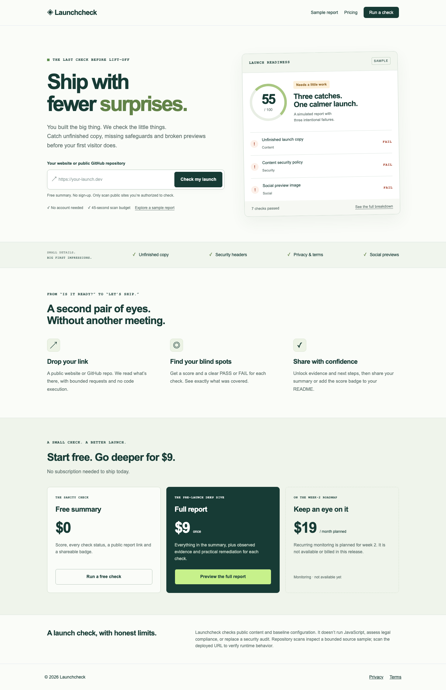
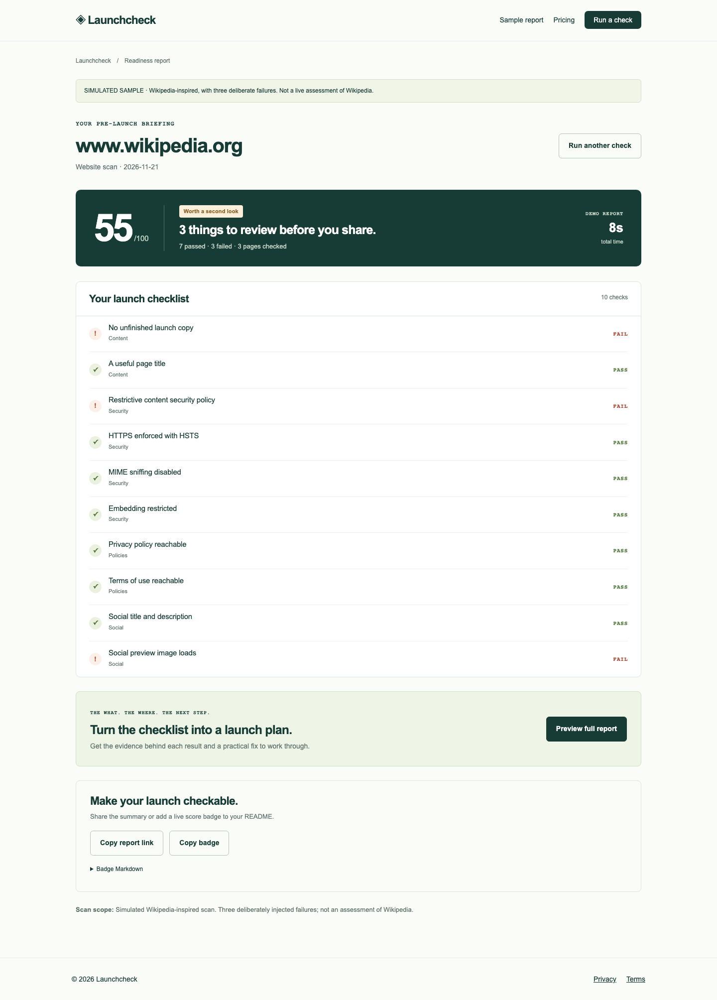
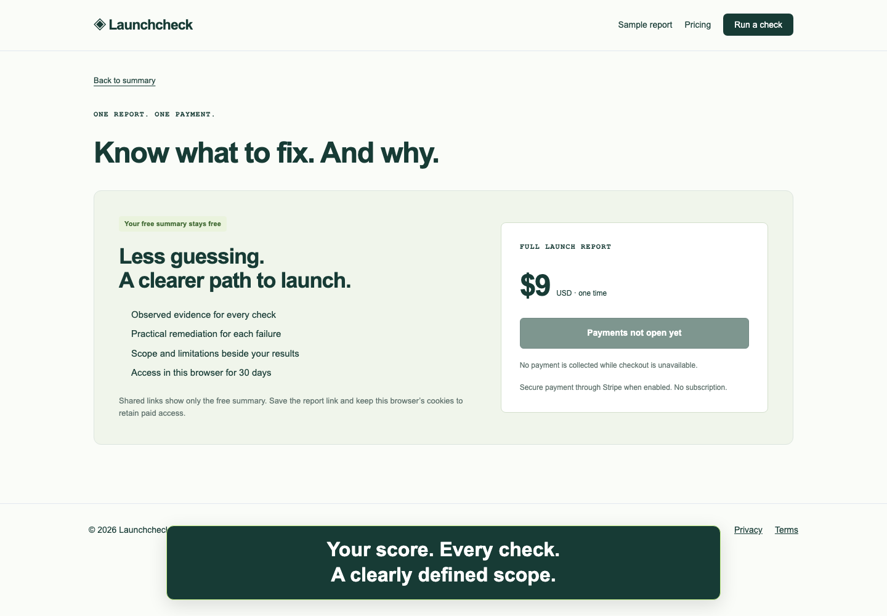
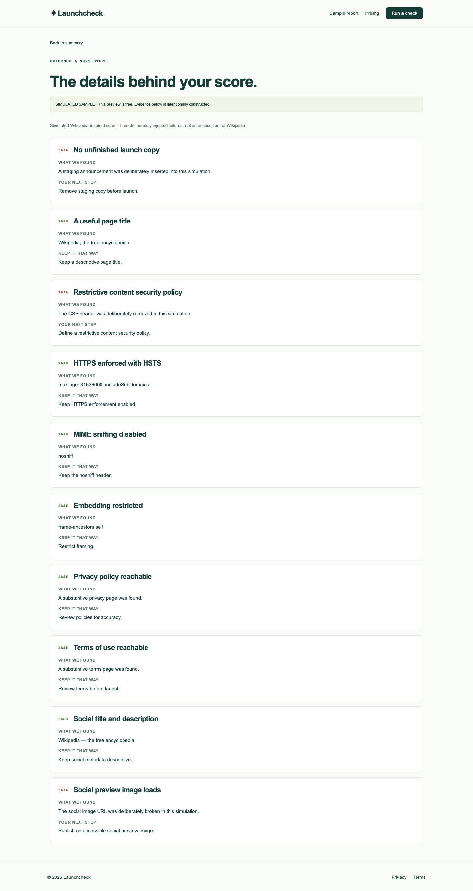
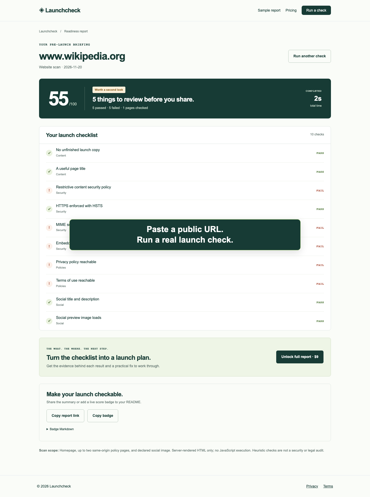
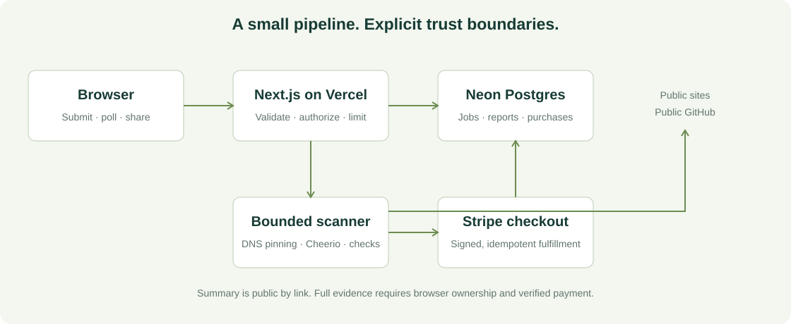
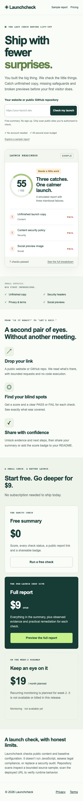
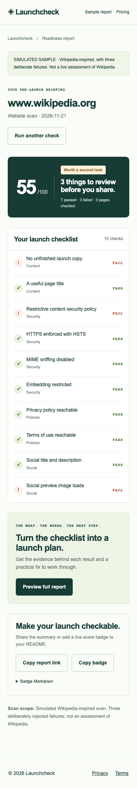
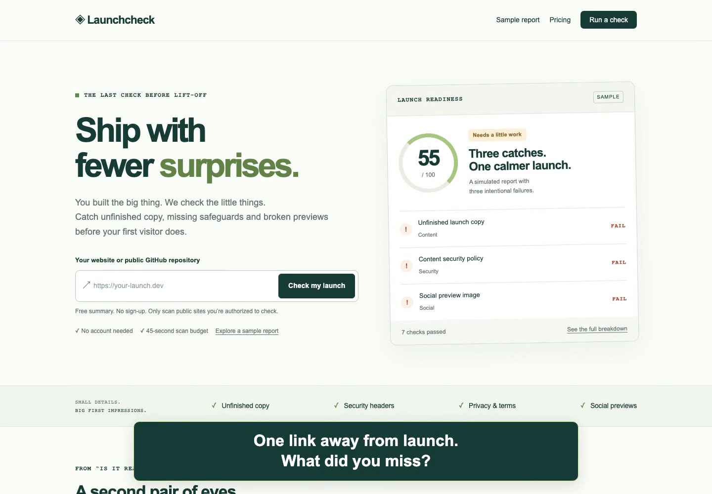

<p align="center"></p>
<p align="center">A second pair of eyes before your first visitor.</p>
<p align="center">
<a href="package.json"></a>
<a href="LICENSE"></a>
<a href="package.json"></a>
<a href="https://launchcheck-sayed.vercel.app"></a>
</p>

## The problem

You’re a solo maker or hackathon team, one day from shipping. The core flow works. But is the social card broken? Did staging copy survive? Is the privacy link a dead end?

The job, in plain language: “Before I post this link, tell me what I’m about to regret.” That’s our framing of the problem, not a fabricated customer quote.

## How we felt it

The concrete workflow behind this build was the release checklist itself: opening the page, inspecting headers, checking policy routes, then testing the preview image in another tab. Each check is small. Remembering them all at the end of a build is the hard part.

Launchcheck puts that last-mile review into one bounded scan. It doesn’t replace Lighthouse, a security audit or legal review.

## What we built

### Paste a website or public repository

One input, no account registration. URL scans fetch the homepage, up to two policy pages and the social image. GitHub scans inspect up to 12 source files without executing code.



### A score you can inspect

Every check has a PASS or FAIL, with explicit coverage and limitations. The score is a weighted percentage of passed checks. Repository and website scores cover different evidence and should not be compared as equivalent audits.



### A free summary and a deeper report

The summary stays free. The full report is designed as a $9 one-time unlock with evidence and remediation. **Payments are not open yet:** Stripe credentials and an end-to-end purchase verification remain owner setup. The paywall says so; it never simulates a charge.



### Evidence with practical next steps

The publicly accessible sample has exactly three injected failures. It is Wikipedia-inspired, not a live assessment or endorsement. Real full reports require both verified payment and the creating browser’s private capability.



### A report worth sharing

Copy a summary link or README badge. Public links do not reveal paid evidence. The badge below is the labeled demonstration report, not a claim about Launchcheck’s own security.

[](https://launchcheck-sayed.vercel.app/reports/demo)



## How it works



1. Next.js validates the URL and applies durable per-network and global rate limits.
2. Neon stores a queued scan and an irreversible hash of the browser ownership capability.
3. After-response work atomically claims the job; Cheerio checks bounded, DNS-pinned public responses.
4. The public report exposes statuses and score; private evidence requires ownership and verified payment.
5. Stripe’s signed webhook records an idempotent purchase; monitoring and automatic fixes are outside v1.

## Quickstart

Node 22.13+ and npm. Four commands from a terminal:

```sh
git clone https://github.com/SayedZahur786/launchcheck.git && cd launchcheck
npm ci
cp .env.example .env.local
npm run dev
```

Open [localhost:3000](http://localhost:3000). The explicit local file store supports development; Vercel refuses to use it. For production, follow [deployment and configuration](docs/OPERATIONS.md). Neon migrations and the restricted runtime-role setup are scripted.

## Screenshots

All PNGs are real Playwright captures of the production build, including desktop and mobile versions of the home, sample summary, full sample, privacy, terms and 404 routes. No fabricated browser mockups.

<p> </p>

[Privacy](docs/screenshots/privacy-desktop.png) · [Terms](docs/screenshots/terms-desktop.png) · [404](docs/screenshots/404-desktop.png) · [All captures](docs/screenshots)

Regenerate with `npm run build && npm run shots`. [shots.spec.ts](tests/shots.spec.ts) starts the production server through the Playwright configuration.

## Demo video

[](docs/demo.mp4)

[Watch or download the MP4](https://github.com/SayedZahur786/launchcheck/raw/refs/heads/main/docs/demo.mp4). Real browser interaction, synthetic English voice-over and large captions. The preview’s disabled payment state is explained honestly.

[Storyline](docs/demo-story.md) · [Narration timing](docs/demo-transcript.json) · [Recording script](scripts/demo.mjs)

To regenerate on macOS with FFmpeg, Chromium and the Samantha voice installed: start the production server, then `node scripts/demo.mjs`. No external voice API is required.

## Why this is interesting

- **A scanner is also a network boundary.** DNS answers are validated and pinned for each request and redirect. Private, loopback, link-local and mapped private addresses are rejected. This costs more code than a plain fetch, but prevents turning a public scanner into an internal-network proxy.
- **A bounded queue instead of an open-ended crawl.** A Neon row and atomic claim keep jobs durable. A 45-second work budget and fixed response caps contain cost. If a claimed job is interrupted, polling marks it failed after 60 seconds; there is no claim of guaranteed background retries.
- **Pay for evidence, share the checklist.** The server strips detailed evidence from public responses. A 256-bit HTTP-only capability plus a verified Stripe payment unlocks detail. This avoids accounts, but access is browser-bound and expires after 30 days; cross-device recovery is not part of v1.

## Quality and operations

Core tests, browser flows and the shared launch-kit gates are documented in [gate results](docs/GATES.md). Local cold-build mobile LCP measured **660 / 604 / 644 ms** under the kit’s throttling; these are local lab measurements, not field performance or customer metrics.

```sh
npm test
npm run lint
npm run build
npm run test:e2e
```

[Security self-audit](docs/SECURITY.md) · [Product plan and competitor sources](PLAN.md) · [Decisions](DECISIONS.md) · [Launch drafts and human setup](LAUNCH.md)

Week-one targets: **100 completed scans**, **5 paid reports**, and **95% of attempts completed within 60 seconds**. The Neon-backed metrics script reports all three from an explicit campaign start time. No traction is claimed.

## Privacy, limitations and license

[Privacy](https://launchcheck-sayed.vercel.app/privacy) and [Terms](https://launchcheck-sayed.vercel.app/terms) describe actual processing. Operated by [Sayed Zahur](https://github.com/SayedZahur786). Analytics is off; operational counters use scan and verified-purchase records.

No JavaScript execution, private repositories, automatic fixes, ongoing monitoring or legal/security certification. $19/month monitoring is a week-2 roadmap item, not a live subscription. Shared launch-kit components and templates are copied into this independent project. [MIT license](LICENSE).
